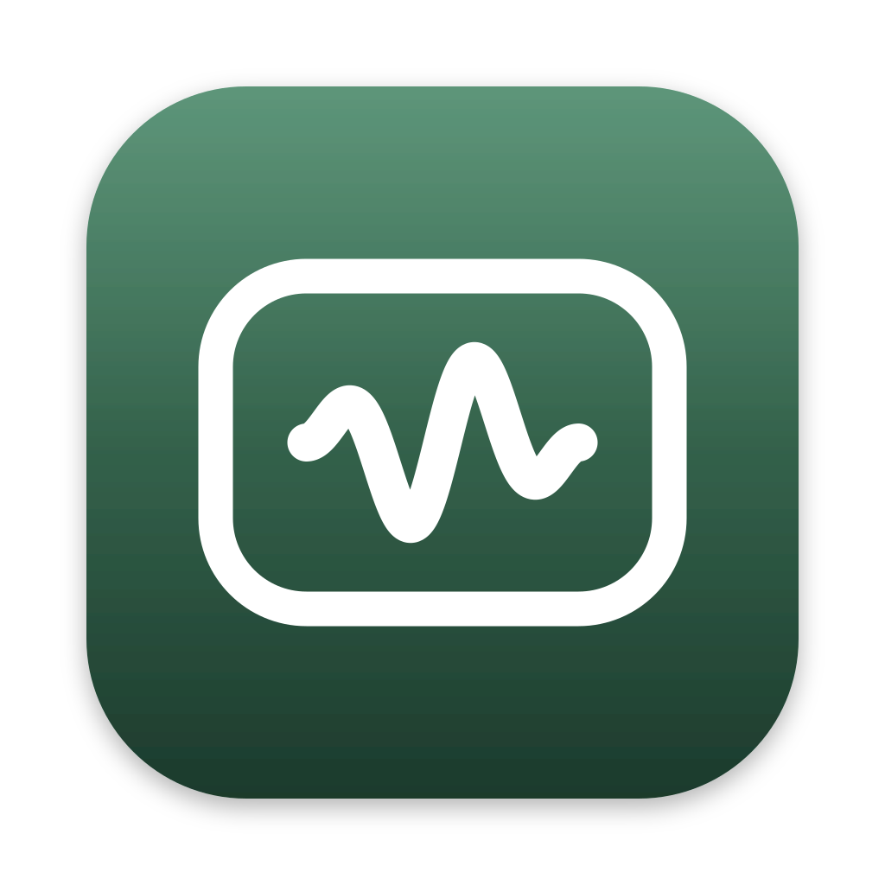
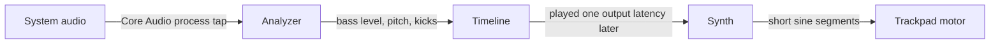

<picture>
  <source media="(prefers-color-scheme: dark)" srcset="assets/banner-dark.svg">
  
</picture>

<br/>

<p>
  
  
  <a href="LICENSE"></a>
</p>

Taptone is a menu bar app that plays the bass of whatever’s on your Mac through the Force Touch trackpad. Rest a fingertip on the trackpad and you feel the low end of a song, a film, or a game, in time with what you hear. Your speakers or headphones keep playing as usual.

## How it feels

- **Bass notes** become a continuous hum that follows how loud the bass is and vibrates in tune with the note.
- **Kicks** land as a short, harder thump on top.
- **Timing** follows your output’s reported latency, Bluetooth included, so the trackpad lines up with your ears.
- **Volume** doesn’t matter: a quiet app, or the volume turned way down, feels as strong as full volume. Turn on **Follow volume** if you’d rather it got weaker with the sound.
- **Silence** sends nothing to the motor.

## Install

Once the first version is released, install it with [Homebrew](https://brew.sh):

```sh
brew install --cask theiskaa/tap/taptone
```

Or download `Taptone-<version>-macos.zip` from [Releases](https://github.com/theiskaa/taptone/releases) and move Taptone to Applications.

### From source

You need macOS 14.2 or later, a Mac with a Force Touch trackpad, and Xcode 16 or later (or the Swift 6 toolchain).

```sh
git clone https://github.com/theiskaa/taptone.git
cd taptone
make install
```

This builds Taptone in release, puts it in `/Applications` (or `~/Applications` if that isn’t writable, or wherever it’s already installed), and opens it. Run it again to update; it replaces a running copy.

> [!TIP]
> If you have an Apple Development certificate in your keychain, the build is signed with it automatically. Otherwise the app is signed ad hoc, and macOS asks for system audio access again after every rebuild, because that permission is tied to the signature. Set `TAPTONE_SIGN_IDENTITY` to choose a certificate.

## Use



1. The first launch opens a welcome window. **Try the motor** plays four kicks, so you know what to feel for. Then click **Continue**.
2. Allow system audio access when macOS asks. This is needed once.
3. Play something and rest a fingertip on the trackpad.

Taptone listens whenever it’s open. The switch at the top of its menu pauses it, and quitting stops it. The menu also sets **Intensity** (how hard the trackpad plays) and **Kicks** (how readily drum hits are picked up).

**Open Taptone** shows the main window: the bass note being played and the last 12 seconds, with all the settings below.

| Setting | What it does |
| --- | --- |
| **Intensity** | Light, medium, or strong. |
| **Kick sensitivity** | Low, normal, or high. |
| **Follow volume** | Off: the same strength at any volume. On: haptics get weaker as you turn the sound down. |
| **Haptic delay** | Starts at the output’s reported latency. If haptics feel early or late, adjust it 10 ms at a time. |
| **Open at login** | Opens Taptone, listening, when you log in. |

With nothing playing, Taptone waits quietly and picks up again when audio starts. When the audio output changes, for example when headphones connect, it reconnects to the new output on its own. It pauses during sleep and screen lock, and picks up again when you’re back. It doesn’t use the microphone, and audio is never saved or uploaded.

## Troubleshooting

**The menu says “Can’t hear system audio”.** Choose **Allow system audio access…** in the menu and turn Taptone on under *Screen & System Audio Recording*. If it was turned on for an older build, reset the permission and open Taptone again:

```sh
tccutil reset All com.theiskaa.taptone
```

**Nothing happens on the trackpad.** Check that *Force Click and haptic feedback* is on in Trackpad settings, then use **Diagnostics → Welcome…** to play the four test kicks. If the motor can’t be opened, Taptone falls back to standard taps on each kick, and the menu says “Standard taps”.

**Haptics feel early or late.** Choose **Open Taptone** in the menu and adjust **Haptic delay**, 10 ms at a time.

**Logs.** `make run` builds a debug app with diagnostics on. Watch it with:

```sh
/usr/bin/log stream --level info --predicate 'subsystem == "com.theiskaa.taptone"'
```

## Uninstall

```sh
make uninstall              # quit and remove the app
scripts/uninstall.sh --purge  # also forget its settings and audio permission
```

## How it works



1. **Capture.** A Core Audio process tap copies what the Mac is playing, after each app’s own volume. Playback is untouched.
2. **Analyze.** Every 5 ms the analyzer normalizes the level, tracks the bass envelope and its pitch, and marks kicks.
3. **Schedule.** Each result is stamped with the time it will reach your ears: now, plus the output device’s latency, plus your adjustment.
4. **Play.** A dedicated thread turns the result into back-to-back sine segments, a few milliseconds each. The carrier sits between 100 and 280 Hz, folded by octaves so it stays in tune with the bass note. Kicks add a falling chirp.

Taptone drives the motor through Apple’s private MultitouchSupport framework, because the public haptics API only offers a fixed, faint tap. A future macOS update could break this; if it does, Taptone falls back to standard taps. It also means Taptone can’t be distributed through the Mac App Store. Output is capped below the motor’s maximum, and nothing is sent during silence.

## Development

```sh
make build   # debug build
make test    # unit tests
make run     # debug app with diagnostics
make app     # .build/Taptone.app in release
make dist    # zip it into dist/ (local only)
make brand   # redraw the icon, logo, and banners
make release-dry-run  # build, sign, and check a release without publishing
```

`TAPTONE_MOTOR_CHECK=1 swift test` also plays one light kick on the real trackpad.

For screenshots, `open .build/Taptone.app --args --demo --open` plays the generated demo instead of listening, never touches the trackpad, and opens the main window. `--welcome` opens the welcome window. Each flag also works as an environment variable, such as `TAPTONE_DEMO=1`.

| Module | Role |
| --- | --- |
| `Taptone` | The app: menu, windows, and session lifecycle. |
| `TaptoneAudio` | System audio capture and output device info. |
| `TaptoneCore` | Analysis, synthesis, and scheduling. Pure Swift, fully tested. |
| `TaptoneHaptics` | The trackpad motor and its playback thread. The only module that uses private API. |
| `AudioListener`, `AudioMailbox` | Small C and Objective-C pieces for Core Audio callbacks. |
| `TaptoneFixtures` | Writes synthetic test audio with known beats. |

## Releasing

See [RELEASING.md](RELEASING.md). `make release VERSION=X.Y.Z` signs, notarizes, tags, publishes the release, and updates the Homebrew cask.

## License

[MIT](LICENSE)
