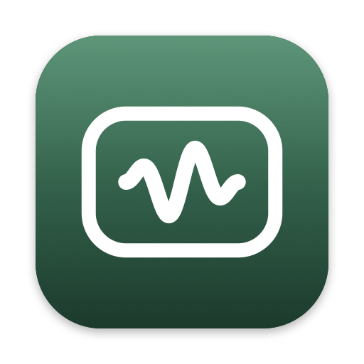

<p align="center">
  
</p>

<h1 align="center">Taptone</h1>

<p align="center">Feel the bass through your trackpad.</p>

<p align="center">
  
  
  <a href="LICENSE"></a>
</p>

Taptone is a menu bar app that plays the bass of whatever’s on your Mac through the Force Touch trackpad. Rest a fingertip on the trackpad and you feel the low end of a song, a film, or a game, in time with what you hear. Your speakers or headphones keep playing as usual.

## How it feels

- **Bass notes** become a continuous hum that follows how loud the bass is and vibrates in tune with the note.
- **Kicks** land as a short, harder thump on top.
- **Timing** follows your output’s reported latency, Bluetooth included, so the trackpad lines up with your ears.
- **Volume** doesn’t matter: a quiet app, or the volume turned way down, feels as strong as full volume. Turn on **Follow volume** if you’d rather it got weaker with the sound. Muting always stops it.
- **Silence** sends nothing to the motor, and neither do macOS alert sounds.

## Install

Once the first version is released, install it from Terminal:

```sh
curl -fsSL https://raw.githubusercontent.com/theiskaa/taptone/main/install.sh | sh
```

The script downloads the latest release, checks that it’s signed by its developer and notarized by Apple, puts Taptone in Applications and opens it. Run the same command to update.

Or download `Taptone-<version>-macos.zip` from [Releases](https://github.com/theiskaa/taptone/releases) and move Taptone to Applications.

### From source

You need macOS 14.2 or later, a Mac with a Force Touch trackpad, and Xcode 16 or later (or the Swift 6 toolchain).

```sh
git clone https://github.com/theiskaa/taptone.git
cd taptone
make install
```

This builds Taptone in release, puts it in `/Applications` (or `~/Applications` if that isn’t writable, or wherever it’s already installed), and opens it. Run it again to update; it replaces a running copy.

> [!TIP]
> If you have an Apple Development certificate in your keychain, the build is signed with it automatically. Otherwise the app is signed ad hoc, and macOS asks for system audio access again after every rebuild, because that permission is tied to the signature. Set `TAPTONE_SIGN_IDENTITY` to choose a certificate.

## Use

1. The first launch opens a welcome window. **Try the motor** plays four kicks, so you know what to feel for. Then click **Continue**.
2. Allow system audio access when macOS asks. This is needed once.
3. Play something and rest a fingertip on the trackpad.

Taptone lives in the menu bar and listens whenever it’s open. The switch at the top of its menu pauses it until you resume, **Pause for 1 Hour** pauses it for a while, and quitting stops it. The menu also sets **Intensity** (how hard the trackpad plays) and **Kicks** (how many drum hits come through).

**Open Taptone** shows the main window, as does opening Taptone again from Finder or Spotlight: the bass note being played and the last 12 seconds, with all the settings below.

| Setting | What it does |
| --- | --- |
| **Intensity** | Light, medium, or strong. |
| **Kicks** | Fewer, normal, or more. |
| **Follow volume** | Off: the same strength at any volume. On: haptics get weaker as you turn the sound down. |
| **Try the motor** | Four test kicks, with no audio. |
| **Pause during calls** | On by default. Haptics pause while an app uses the microphone, and pick up again when the call ends. |
| **Ignored apps** | Apps whose sound never reaches the trackpad. Safari and other WebKit browsers can’t be ignored. |
| **Haptic delay** | Starts at the output’s reported latency. If haptics feel early or late, adjust it 10 ms at a time. |
| **Open at login** | Opens Taptone, listening, when you log in. |
| **Pause shortcut** | ⌃⌥⌘P pauses or resumes from any app. |
| **Check for updates** | Once a day, asks GitHub for the latest version. |

With nothing playing, Taptone waits quietly and picks up again when audio starts. When the audio output changes, for example when headphones connect, it reconnects to the new output on its own. It pauses during sleep and screen lock, and picks up again when you’re back. It never records the microphone, only notices whether one is in use, and audio is never saved or uploaded.

## Troubleshooting

**The menu says “Can’t hear system audio”.** Choose **Allow system audio access…** in the menu and turn Taptone on under *Screen & System Audio Recording*. If it was turned on for an older build, reset the permission and open Taptone again:

```sh
tccutil reset All com.theiskaa.taptone
```

**Nothing happens on the trackpad.** Check that *Force Click and haptic feedback* is on in Trackpad settings, then play the four test kicks with **Try the motor** in the main window. Taptone needs a Force Touch trackpad: the one built into a MacBook, or a Magic Trackpad 2 or later. With the lid closed, it plays on a connected Magic Trackpad.

**Haptics stopped during a call, or when nothing’s playing.** **Pause during calls** holds haptics while any app uses the microphone, including dictation apps. Turn it off in the main window if that’s not what you want.

**Haptics feel early or late.** Choose **Open Taptone** in the menu and adjust **Haptic delay**, 10 ms at a time.

**Logs.** Quit Taptone, open it again with diagnostics on, then watch what it does:

```sh
open -a Taptone --args --diagnostics
/usr/bin/log stream --level info --predicate 'subsystem == "com.theiskaa.taptone"'
```

## Uninstall

Quit Taptone and move it to the Trash. To also forget its settings and audio permission:

```sh
defaults delete com.theiskaa.taptone
tccutil reset All com.theiskaa.taptone
```
